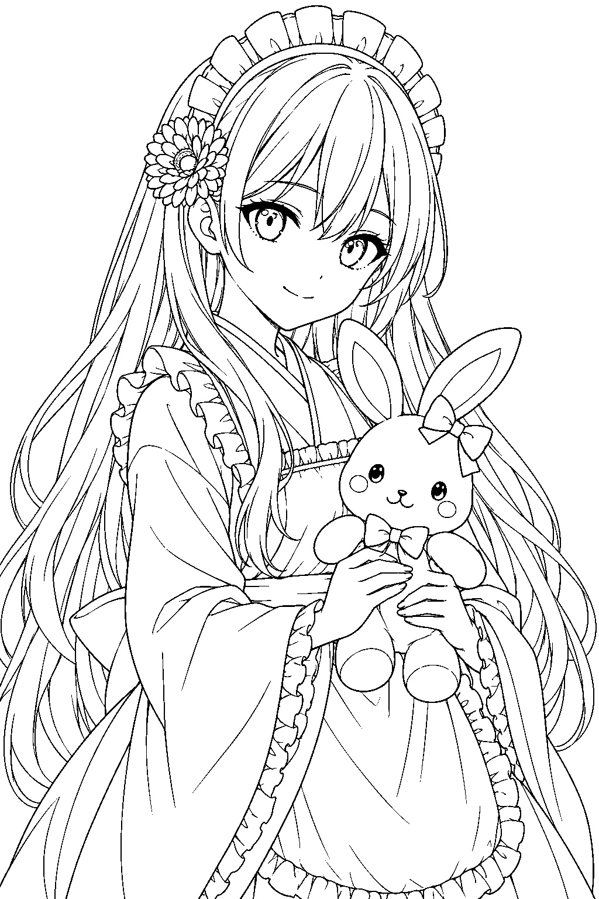
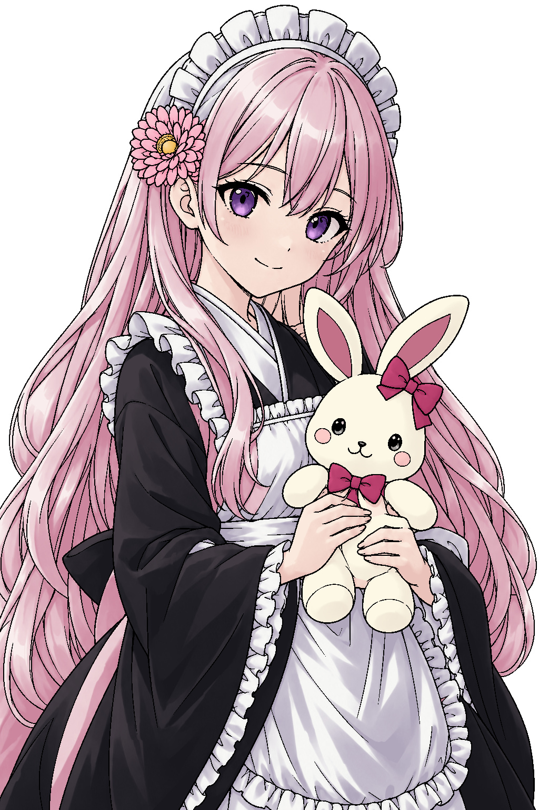
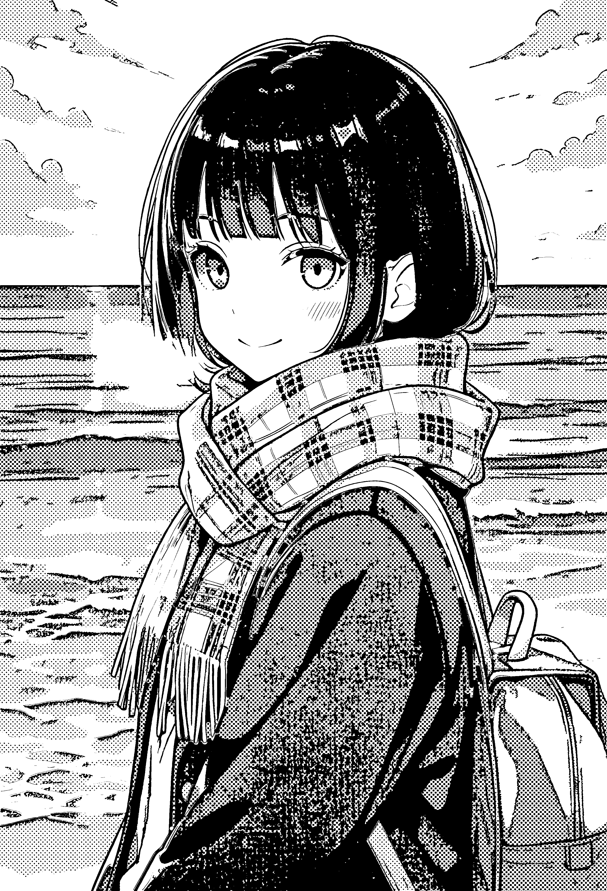
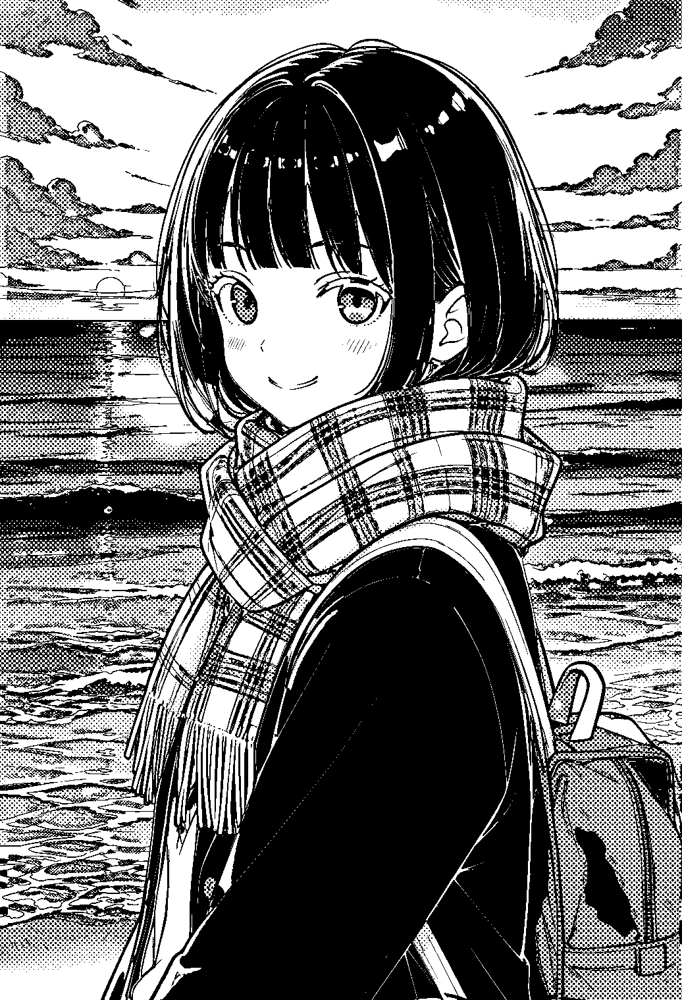
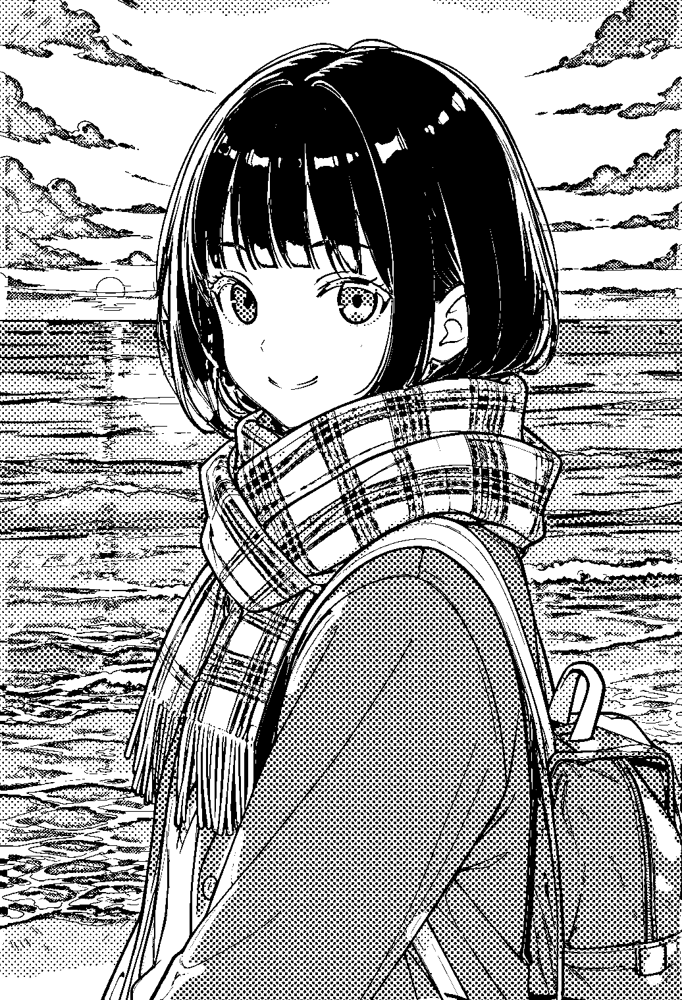

# PsdMaker

イラストを、色・影・線を編集しやすいPSDにするCodex Agent＋ローカルPythonツールです。完成イラストを編集可能なPSDにする「第1機能」と、その素材情報を別の線画へ引き継ぐ「第2機能」があり、それぞれカラー版とトーン版を使えます。

Codex Astraが画像を見て髪・肌・衣装・背景などの意味を判断し、Pythonが位置合わせ、領域抽出、マスク・色計算、PSD保存、読み戻し評価を担当します。

作例を見る： [カラー版](#作例カラー版) ／ [トーン版（入力カラー画像・トーン化）](#作例トーン版)

## 第1・第2機能とカラー版・トーン版

| 機能 | できること | 入力 | 出力 |
|---|---|---|---|
| 第1機能（カラー版）：イラストを編集しやすいPSDにする | 1枚の完成イラストを、髪・肌・服・線・背景などを編集しやすいレイヤーに分けたPSDにします。 | 完成イラスト。できれば同じ構図の線画も使います。 | レイヤー分けしたPSDと、次の着色に使える色情報 |
| 第2機能（カラー版）：別の線画を同じ配色で着色する | 第1機能で作った色情報を使い、別ポーズなどの線画を同じキャラクターらしい色で着色したPSDにします。 | 着色したい線画＋第1機能で作ったPSDと色情報 | レイヤー分けした着色済みPSD。必要なら影・ハイライトも追加できます。 |
| 第1機能（トーン版）：カラーイラストを漫画原稿風にトーン化する | 髪・肌・服などのパーツごとに、白・トーン・ベタを決めてモノクロ漫画の原稿にします。 | カラーイラスト（線画は任意） | 線画・ベタ・ホワイト・パーツ別トーンに分けたPSDとtone_reference.json。原寸PNGも出力できます。 |
| 第2機能（トーン版）：別線画にトーンを貼る（検証中） | 第1機能（トーン版）の素材別濃度を別ポーズなどの線画へ引き継ぎます。 | 新しい線画＋参照job、またはPSDとtone_reference.json | 原寸PNGとレイヤー分けしたPSD。アジャスト画面で領域・濃度・網を調整できます。 |

第2機能は着色・トーン貼りをする線画を指定したとき、第1機能（トーン版）は漫画化を依頼したときだけ動きます。別ポーズの線画を自動で作ったり、頼んでいない着色を始めたりはしません。

PSDの中では、たとえば「服 → 袖 → ベース色・影・ハイライト」のようにレイヤーを整理します。レイヤーはPhotoshopなどで自由に編集できますが、同じ色のレイヤーを変えても他のレイヤーが自動で連動するわけではありません。

Codexは、GPT-6 Astra Light(low) 以上を推奨します。Claudeなど他の生成AIモデルは検証していません。
動作検証は、長辺1280px（または画素数1Mpx）程度のイラストや線画をインプットとして実施しています。大きい画像の場合は時間がかかったり、トークン消費量が飛躍的に増大する可能性があります。

本機能の使い方については、git cloneしてCodexに「このフォルダで何ができる？」のように聞いてみるのが手取り早いかと思います。

## 重要な注意

- **第三者のイラストや、権利・外部AI利用の許諾が不明な画像は入力しないでください。** 入力できるのは、利用者が権利を持つか、権利者から外部AIへの送信・解析・再構成・PSD出力に必要な許諾を得た画像だけです。公開画像、依頼で預かった原稿、二次創作、版権キャラクター、スクリーンショット、人物写真、機密情報なども、入力してよいとは限りません。
- **Codexの利用を前提とします。** 画像と作業指示は、利用中のCodexおよび必要に応じた画像生成機能の提供事業者へ送信されます。国外を含むサーバへの送信、保存、安全確認、人による確認、モデル改善・学習等の扱いが生じる可能性は、利用中のプラン・設定・規約・仕様に依存します。作者はそれらを管理できず、送信後の完全削除も保証できません。機密性または権利関係に懸念のある画像は使用しないでください。
- **出力品質・用途適合性は保証しません。** パーツの欠落や混入、境界・細線・色・透過の不正確さ、PSD編集時の互換性問題などが起こり得ます。公開、納品、印刷その他の利用前に、必ず利用者自身で確認・修正してください。

## 作例（カラー版）

左の画像のような、レイヤー分けされていない完成イラストを第1機能へ渡すと、髪・服・肌・線などを編集しやすく分けたPSDを作れます。

そのPSDと一緒に出力される色情報を保存しておけば、第2機能で指定した線画を着色できます。中央は今回の着色用線画、右はBase色を引き継いで影・ハイライトを付けた最新の着色PSDです。

| 第1機能の入力 | 第2機能の線画 | 第2機能の着色結果 |
|---|---|---|
|  |  |  |

- [第1機能の編集可能PSD](examples/output/output.psd) ／ [配色・意味情報JSON](examples/output/coloring_reference.json)
- [第2機能の線画JPG](examples/coloring/lineart.jpg) ／ [着色PSD](examples/coloring/output.psd)
- [第1機能の完成プレビュー](examples/output/preview.jpg)
- [法線マップ方式の着色PSD](examples/coloring_normals/output.psd) ／ [プレビュー](examples/coloring_normals/preview.jpg)
- [作例の仕様・検証結果・制約](examples/README.md)

第2機能の作例は、手を振る参照イラストとは異なる「両手でうさぎを抱えるポーズ」の線画を、`examples/output` のPSDとJSONから引き継いだBase色で着色したものです。新しい線画の領域を確認して素材を割り当て、通常の第2機能の手順でPSDを作成しました。主例はCodex組込みimagegenによる照明案を使い、法線マップ方式も同じ別ポーズの比較例として用意しています。

**通常は利用者が着色したい線画を用意します。今回の線画は、機能を説明する作例の作成用としてimagegenで生成したものです。線画の自動生成は通常の第2機能には含まれません。** JPGのEXIF/XMP・コメント・生成情報は除去しています。細い線の途切れや照明の細部ずれが残り、制作実務にそのまま使える品質を保証するものではありません。

## 作例（トーン版）

第1機能（トーン版）の入力はカラー画像です。左は今回指定された海辺の原画の公開用コピーです。QwenImage2.1で再描画し、Manga Line Extractionで線を抽出してトーン化しました。掲載しているのは、初回の既定値による出力から利用者が調整したPSDです。プレビューもそのPSDから再出力しています。Codexによる追加の数値調整は行っていません。

| 第1機能の入力：カラー画像 | 第1機能の出力：トーン化結果 |
|---|---|
|  |  |

- [第1機能の入力カラー画像](examples/manga/reference.jpg)
- 第1機能：[原寸PNG](examples/manga/preview.png) ／ [編集可能PSD](examples/manga/output.psd) ／ [トーン情報JSON](examples/manga/tone_reference.json) ／ [線画PNG](examples/manga/lineart.png)
- [作例の作り方・検証結果・制約](examples/README.md#トーン版)

第1機能は2793×4096px・600dpi・26描画レイヤー、9パーツです。背景は1パーツにまとめ、ハイライトと影を別レイヤーにしました。画像幅基準の網点列数200を使い、PNGとPSD読み戻しは全画素一致です。線には粒状の跡が残ります。設定と詳しい制約は作例説明を参照してください。

### imagegenのみの作例

同じカラー原画から、線画・モノクロの再描画ガイド・背景を削除した透過画像をimagegenで作りました。透過画像のalphaを使って被写体と背景を分け、原画を見てパーツを新しく割り当てています。この例ではQwenの生成画像・抽出線・マスクを使っていません。

| ツールの既定値 | Codexが閾値などを調整 |
|---|---|
|  |  |

- 既定値版：[PNG](examples/manga_imagegen_default/preview.png) ／ [PSD](examples/manga_imagegen_default/output.psd) ／ [トーン情報JSON](examples/manga_imagegen_default/tone_reference.json) ／ [PSDの線画](examples/manga_imagegen_default/lineart.png)
- 調整版：[PNG](examples/manga_imagegen_adjusted/preview.png) ／ [PSD](examples/manga_imagegen_adjusted/output.psd) ／ [トーン情報JSON](examples/manga_imagegen_adjusted/tone_reference.json) ／ [PSDの線画](examples/manga_imagegen_adjusted/lineart.png)
- 共通の生成素材：[入力線画](examples/manga_imagegen_default/input_lineart.png) ／ [再描画ガイド](examples/manga_imagegen_default/redraw.png) ／ [背景削除版](examples/manga_imagegen_default/foreground.png)

拡大せず1036×1519pxで作成し、各25描画レイヤー＋17フォルダ、9パーツです。背景は1パーツで、影と白ハイライトは独立しています。既定値版は数値と各パーツのトーン指定を変更していません。依頼に基づく調整版はコートと背景のベタをトーンへ変え、コートのしわが見えるようにしました。

PSDの線画は入力線画に再描画由来の線を加えたものです。変更した数値と検証結果は[imagegenのみの作例](examples/README.md#imagegenのみの作例)を参照してください。

## セットアップ

- Python 3.12以上（プレビューにはTkinterが必要）
- Windows環境（付属BATを使う場合）
- 初回の依存インストールに必要なインターネット接続
- このフォルダを読み書きでき、画像を確認できるCodex環境

リポジトリ直下で実行します。

```powershell
.\setup.bat
```

依存パッケージはプロジェクト内の `.venv` に入ります。ローカルCLIはOpenAI APIキーを要求しません。モデルは利用者のCodex画面で選択します。Codexや任意の画像生成機能の利用条件・料金は利用中のサービスを確認してください。

## 第1機能（カラー版）を使う

`input/` を作り、完成画像と対応する線画を配置します。このフォルダをCodexで開き、次のように依頼します。

```text
AGENTS.mdとdocs/ARTIST_WORKFLOW.mdを読み、
input/reference.pngとinput/lineart.pngからoutput/my_job/output.psdを作成してください。
描画レイヤー数と色統一許容値はお任せします。
位置合わせ、意味分類、編集設定、PSD生成、評価、事後レビューまで進めてください。
```

「描画レイヤー数は100〜180枚、色統一許容値は30」のようにも指定できます。描画枚数はフォルダを含みません。色統一許容値は0〜100で、値を上げるほど同素材の塗り色を揃えやすくします。未指定・お任せの場合は素材数と色のばらつきから計算します。

線画がない場合は、利用中の環境に画像生成機能があれば作成を依頼できます。生成線画の形状差を確認し、原画を変形せず線画側を位置合わせします。

`start_preview.bat` を開くと別ウィンドウでPSD・参照・差分・線画・背景・配色を表示できます。PSDができるまでは待機し、保存後に表示を更新します。起動は任意です。

主な成果物は `output.psd`、`coloring_reference.json`、再合成画像、`analysis.json`、意味計画、比較画像・事後レビュー結果です。`work/my_job/` には領域・マスクと再開用キャッシュを保存します。

## 第2機能（カラー版）を使う

第1機能を終えると、出力先に `output.psd` と `coloring_reference.json` が作られます。この2つは、元の絵のどの部分をどんな色で塗ったかを第2機能へ伝えるためのセットです。削除せず、同じ場所に保管してください。

次に着色したい線画を用意し、このフォルダをCodexで開いて、次のように依頼します。`my_first_job`、ファイル名、出力先は自分のものに置き換えてください。

```text
AGENTS.mdとdocs/COLORING_WORKFLOW.mdを読み、input/new_pose_lineart.pngを着色してください。
第1機能で作ったoutput/my_first_job/output.psdと、その隣のcoloring_reference.jsonを参照してください。
新しいjobはwork/my_new_pose、出力はoutput/my_new_pose/output.psdにしてください。
参照パレットの意味確認、下塗り、PSD生成、事後レビューまで進めてください。
```

まずは「下塗りだけ」と頼んでも構いません。影・ハイライトもほしい場合は、依頼文に追加してください。第2機能では新しい線画の各部分を確認してから着色するため、元の絵の位置をそのままコピーするものではありません。

影・ハイライトを付ける際は、元PSDの完成色も参照します。出力後は髪・肌・白布などの明るさと色味を素材別に比較し、ベース色が同じでも暗さや色抜けが起きていないか確認します。

第1機能で作ったPSDと `coloring_reference.json` があれば、元の `work/` フォルダがなくても着色を続けられます。線画は別ポーズでもかまいませんが、同じキャラクター・衣装を想定したものが扱いやすくなります。

以前に作ったjobへJSONを追加する場合:

```powershell
.\.venv\Scripts\python.exe -m anime_layer_agent export-coloring-reference --job work/source
```

## 第1機能（トーン版）を使う

カラーイラストを `input/` に置き、このフォルダをCodexで開いて次のように依頼します。

```text
AGENTS.mdとdocs/MANGA_WORKFLOW.mdを読み、input/color.pngを漫画原稿風にトーン化してください。
再描画はimagegen（またはQwen-Image 2.1）、トーンは網点でお願いします。
jobはwork/my_manga、出力はoutput/my_manga/output.psdにしてください。
```

- 再描画（白・黒・トーンの判断）と線の抽出には、Codex組込みのimagegenか、ComfyUI上のQwen-Image 2.1を選べます。Qwenを使う場合は先にComfyUIを起動してください（Qwen-Image 2.1対応版と、線抽出用のcomfyui_controlnet_auxが必要です）。
- QwenImageでAI編集する際の既定サイズは1Mpxです。必要な場合は`run-comfy-manga --megapixels 2`のように変更できます。
- 画像生成のために元画像を縮小した場合は、縮小倍率と生成画像のサイズから元のサイズへ戻して位置を合わせます。元画像は変形しません。
- パーツ分けはCodexがカラーの原画を見て判断します。トーン化は通常、ツールの既定値とパーツごとの自動判定を使い、Codexによる濃度・網・閾値の調整を挟みません。推奨設定を依頼した場合だけ、Codexが調整案を提示・適用します。指定した数値は優先され、利用者自身がアジャスト画面で調整することもできます。
- PSDは上から「ホワイト」「線画」「ベタ・トーン（衣装→パーツ→ベタ／ハイライト／影／ベース）」「紙」の順です。ベタの下にもトーンを敷いてあるので、ベタを削るとその部分はトーンになります。ごく小さな黒の粒は、AI再描画のノイズとしてベタから除きます。網点は全レイヤー共通の角度・線数なので、パーツを重ねてもモアレが出ません。CLIP STUDIO PAINTでトーン化したい場合は、グレー塗りの形式も選べます。

トーン化の処理は [ComfyUI-MangaScreen](https://github.com/ashukae/ComfyUI-MangaScreen)（MIT License）を元にしています。

生成・位置合わせ・パーツ確認後は、通常そのまま既定値でPNG・PSDを出力します。利用者が調整したい場合は、`start_manga_adjust.bat` で調整画面を開けます。「MangaScreen方式」と「階調化方式」を切り替え、スライダーや階調バーで数値を変え、「反映」でプレビューを更新、「PSD出力」または「PNG出力」で保存します。階調化方式ではトーン線数（LPI）・dpi・階調の境界・段階ごとの濃度（ベタ100%とホワイト0%は固定）を指定できます。よく使う設定は「プリセットとして保存」で名前を付けて保存し、「プリセットを読み込む」で呼び出せます。コマ枠・紙質は将来の実装予定です。

利用者が前回の適用値の再利用を選ぶ場合（新規の既定値制作では使いません）:

```powershell
.\.venv\Scripts\python.exe -m anime_layer_agent export-manga --job work/my_manga --reuse-last --output output/my_manga/output.psd
.\.venv\Scripts\python.exe -m anime_layer_agent export-manga-png --job work/my_manga --reuse-last --output output/my_manga/output.png
```

PSD出力は読み戻し検証と事後確認画像の生成まで自動で行い、PSDの隣に第2機能へ引き継ぐ `tone_reference.json` を保存します。PNG出力は原寸の合成画像を保存します。目視確認とPSDの `finish-review` は別途必要です。操作方法・設定保存先は [漫画トーン化の手順](docs/MANGA_WORKFLOW.md) を参照してください。

## 第2機能（トーン版）を使う（検証中）

第2機能（トーン版）は現在、出力品質を検証中です。

`start_manga_adjust.bat` を開いて「別線画へトーン」を押し、参照job（またはPSDと同じ場所にある `tone_reference.json`）、新しい線画、新規作業フォルダを選びます。

画面で参照素材と「ベース・影・ハイライト・ベタ」を選び、新線画の領域をクリックして割り当てます。ピンクは未割当です。各素材の濃度と網の設定は通常そのまま引き継ぎ、利用者は必要に応じて調整できます。全領域を目視確認して「反映」すると、原寸プレビューからPNG・PSDを出力できます。影や光を貼る場所は新線画の閉領域へ指定します。

第1・第2機能のトーンPSDには `tone_reference.json` が付属します。PSDとJSONを同じフォルダで保管すれば、元のjobがなくても引き継げます。以前のjobへのJSON追加と新線画の準備をCLIで行う場合:

```powershell
.\.venv\Scripts\python.exe -m anime_layer_agent export-tone-reference --job work/my_manga
.\.venv\Scripts\python.exe -m anime_layer_agent prepare-tone-transfer --lineart input/new_lineart.png --source-job work/my_manga --job work/new_tones
.\start_manga_adjust.bat --job work/new_tones
```

画面で全領域の素材・役割を割り当て、目視確認のチェックを入れて「反映」します。その後、画面の出力ボタンまたは次のコマンドで保存します。`--reuse-last` は保存済みの調整値を使う指定で、領域の確認を省略するものではありません。

```powershell
.\.venv\Scripts\python.exe -m anime_layer_agent export-manga-png --job work/new_tones --reuse-last --output output/new_tones/output.png
.\.venv\Scripts\python.exe -m anime_layer_agent export-manga --job work/new_tones --reuse-last --output output/new_tones/output.psd
```

PNGとPSDは同じ描画処理を使います。参照のポーズ・マスクは移植せず、新線画の線を二値化して固定します。詳しくは [第2機能（トーン版）の手順](docs/TONE_TRANSFER_WORKFLOW.md) を参照してください。

## CLIと作業手順

Codexに作業を依頼して使う場合は、この章は読み飛ばして大丈夫です。ここは、Pythonのコマンドを自分で実行して、処理の準備・確認・PSD作成を進めたい人向けです。

CLIでは、画像と線画の位置合わせ、塗る場所の一覧作成、PSDの組み立て、出力後の確認画像作成などを実行できます。ただし「ここは髪」「ここは服」といった絵の意味を判断して計画へ書き込む作業は別に必要です。コマンドだけを順番に実行しても、確認なしに完成PSDができるわけではありません。

```powershell
.\.venv\Scripts\python.exe -m anime_layer_agent --help
.\.venv\Scripts\python.exe -m anime_layer_agent prepare-coloring --lineart examples/coloring/lineart.jpg --source-reference examples/output/coloring_reference.json --job work/coloring_example --gap-close 5 --min-area 20
```

上の `prepare-coloring` は、線画の中から「塗り分ける候補」を見つけて一覧にする準備コマンドです。第2機能（カラー版）を手動で進める場合は、一覧を確認して計画を作り、`paint-flats`（下塗り）、必要に応じて `prepare-lighting`（影・ハイライトの準備）、`build-colored`（PSD作成）、`post-review` と `finish-review`（出力確認）の順に進めます。元の作業フォルダを参照する場合は、`--source-reference` の代わりに `--source-job work/source` を指定します。

- [Agent共通手順](docs/AGENT_WORKFLOW.md)
- [第1機能（カラー版）：編集優先工程](docs/ARTIST_WORKFLOW.md) ／ [位置合わせ・領域抽出](docs/COMPACT_WORKFLOW.md)
- [第2機能（カラー版）：指定線画への着色](docs/COLORING_WORKFLOW.md) ／ [配色JSONの仕様](docs/COLORING_REFERENCE.md)
- [第1機能（トーン版）：漫画トーン化](docs/MANGA_WORKFLOW.md)
- [第2機能（トーン版）：別線画へのトーン貼り](docs/TONE_TRANSFER_WORKFLOW.md) ／ [トーンJSONの仕様](docs/TONE_REFERENCE.md)
- [事後レビュー](docs/POST_REVIEW_CHECKLIST.md) ／ [仕様](docs/SPEC.md)

## 品質と制約

数値合格だけでは意味分離・境界・色やトーンの自然さを証明できません。カラー版は実PSDの色替え、線・背景単独、影・光OFFを確認します。トーン版は線・ベタ・ホワイト・パーツ別トーン、影・光OFF、網点の100%表示を確認し、所見と画像根拠を記録します。

第1機能（カラー版）は原画との差と編集目標からの読み戻し誤差を分けます。第2機能（カラー版）はPythonの着色目標、トーン版の両機能はPythonのトーン描画目標からの読み戻しを評価します。トーン化前のカラー画像や別ポーズの参照画像との画素一致は合否にしません。

- 隠れた髪・腕・衣服の描き足し、Live2D用の完全パーツ展開、ベクター線画は対象外です。
- 開いた線、細い模様、厚塗り、複雑な透過、特殊発光などは正しく分離・着色できない場合があります。
- 線画の二値化やJPG圧縮で細線が変わる場合があります。
- 第2機能（トーン版）は付属の別ポーズ作例でも素材の引き継ぎ・PNG/PSD出力を確認しています。閉じていない領域の陰影は自動生成せず、黒い服の内部線がベタに埋もれるなどの制約が残ります。
- Photoshop／CLIP STUDIO PAINT上での互換性・編集品質は別途確認が必要です。付属作例は実アプリ未検証です。

## 開発用検証

```powershell
.\.venv\Scripts\python.exe -m pytest
.\.venv\Scripts\python.exe scripts/verify_compact.py --job work/my_job
.\.venv\Scripts\python.exe scripts/verify_preview.py
```

CLI終了コードは0がコマンド成功、1が入力・実行エラー、2が数値品質・編集読み戻し・指定枚数・レビュー判定の未達です。buildやpost-reviewの成功だけでは視覚確認は完了しません。

## ライセンス

[Unlicense](LICENSE)です。商用・非商用を問わず、利用・改変・再配布できます。付属の文書・作例も、提供者が権利を持つ範囲で同じ条件とします。依存ライブラリはそれぞれのライセンスに従います。

ただし、トーン版の両機能が使う共通処理の一部（`anime_layer_agent/manga_tone.py` ほか）は [ComfyUI-MangaScreen](https://github.com/ashukae/ComfyUI-MangaScreen)（Copyright (c) 2026 ashukae）のコードを改変して含みます。その部分はMIT Licenseに従います。再配布するときは [THIRD_PARTY_NOTICES.md](THIRD_PARTY_NOTICES.md) の著作権表示と許諾表示を一緒に含めてください。ComfyUIで使うQwen-Image 2.1やManga Line Extractionのモデルは同梱していません。各モデルのライセンスに従ってください。

## 注意および免責事項

本リポジトリは個人が公開するオープンソースソフトウェアです。次を了承したうえで利用してください。

- 入力画像および出力PSDの権利は元の権利者に留まり、作者は出力の著作権を主張しません。ただし、出力の利用可能な範囲は、利用者が入力時点で有していた権利を超えません。AI処理を経ても、第三者の著作物の利用が適法になるわけではありません。
- 法令、利用する外部AIサービスの規約、本READMEの注意に反する利用、権利者を偽る行為、サービスの制限回避、過度な自動実行、出力を第三者学習データとして不当に収集・利用する行為は行わないでください。第三者から権利侵害等の主張を受けた場合は、利用者が自己の責任と費用で対応してください。
- 本ソフトウェアは現状有姿で提供されます。適用法令で認められる最大限の範囲で、作者は、特定目的適合性、非侵害、無欠陥、継続提供、外部AIサービスの可用性、出力品質、データの機密性・完全削除を含む一切の保証をしません。入力・出力・公開・販売・外部送信・情報漏えい・学習利用・アカウント停止・第三者からの請求等により生じた損害について、作者は責任を負いません。
- フォーク、再配布、独自ホスティングを行う人は、その環境の運営者です。外部AIとの契約、料金、データ取扱い、入力確認、苦情対応は運営者自身の責任で行ってください。作者はフォーク先での利用に責任を負いません。

この注意および免責事項は予告なく更新されることがあります。最新版は本リポジトリを確認してください。
